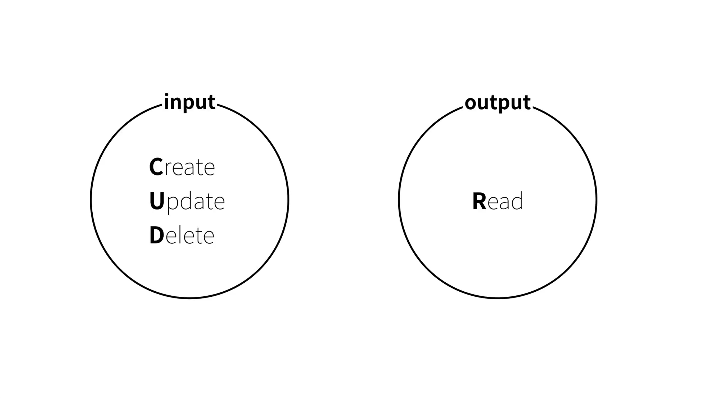
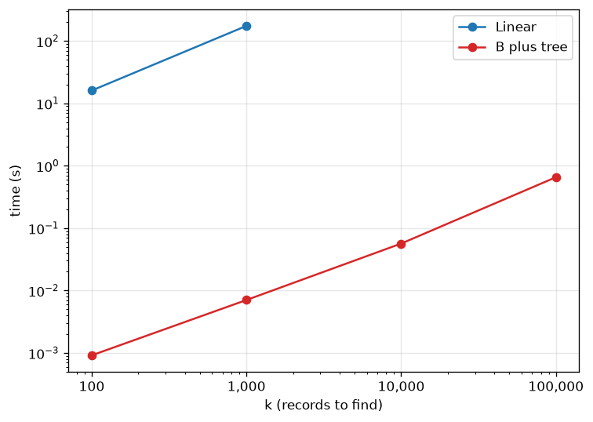
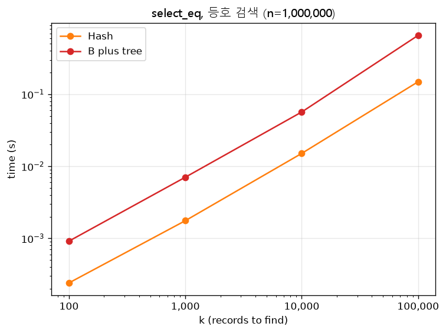

# mini-dbms

> 해시 테이블 vs B+ 트리, 직접 구현하고 측정해 보기

  

## 1. DBMS의 핵심 = 넣고, 꺼내기

| 연산 | 역할 | CRUD |
|---|---|---|
| `insert` | input | **C**reate |
| `select` | output | **R**ead |

  

## 2. 선형 탐색 vs B+ 트리

- 조건: 레코드 100만 개, 랜덤 id k개 등호 검색
- 축: x, y 모두 **로그 스케일**

| k | 선형 탐색 | B+ 트리 | 차이 |
|---|---|---|---|
| 100 | 16.1초 | 0.0009초 | **약 1만 8천 배** |
| 1,000 | 175초 | 0.007초 | **약 2만 5천 배** |

※ 선형 탐색은 k=1만부터 측정 불가 (너무 오래 걸림)

  

## 3. 질문: 해시 테이블만 쓰면 되지 않을까?

- 인덱스의 목적: insert를 조금 희생하고 **select를 빠르게**
- 해시 등호 검색: **평균 O(1)**
- 그럼 해시가 항상 가장 빠를까?

  

## 4. 범위 검색: B+ 트리 승

> 예: "10만 원 이상 20만 원 미만 상품, 가격순으로"

| | 방법 | 시간 복잡도 |
|---|---|---|
| 해시 | key가 흩어져 있음 → **full scan** | O(n) |
| B+ 트리 | 리프가 **정렬된 채 연결** → 시작점부터 이어 읽기 | O(log n + k) |

- 해시: k와 무관하게 약 0.43초 → **선형 탐색(0.62초)과 비슷**
- B+ 트리: **모든 구간에서 해시보다 빠름** (k=100에서 약 1만 5천 배)
<!--  -->

  

## 5. 등호 검색: 해시 승

| | 방법 | 시간 복잡도 |
|---|---|---|
| 해시 | key로 위치를 바로 계산 | 평균 O(1) |
| B+ 트리 | 루트 → 리프까지 내려가기 | O(log n) |

| k | 해시 | B+ 트리 |
|---|---|---|
| 100 | 0.0002초 | 0.0009초 |
| 1,000 | 0.0018초 | 0.0071초 |
| 1만 | 0.015초 | 0.057초 |
| 10만 | 0.15초 | 0.66초 |

- 해시(주황) vs B+ 트리(빨강): **모든 구간에서 해시가 약 4배 빠름**
<!--  -->

  

## 6. 결론

| 연산 | 승자 | 차이 (n=100만) |
|---|---|---|
| 범위 검색 | **B+ 트리** | 약 17 ~ 1만 5천 배 |
| 등호 검색 | **해시 테이블** | 약 4배 |

### 하나만 찾을 때는 해시, 구간을 찾을 때는 B+ 트리

자료구조에 정답은 없다. 쓰임새에 맞게 고른다.
